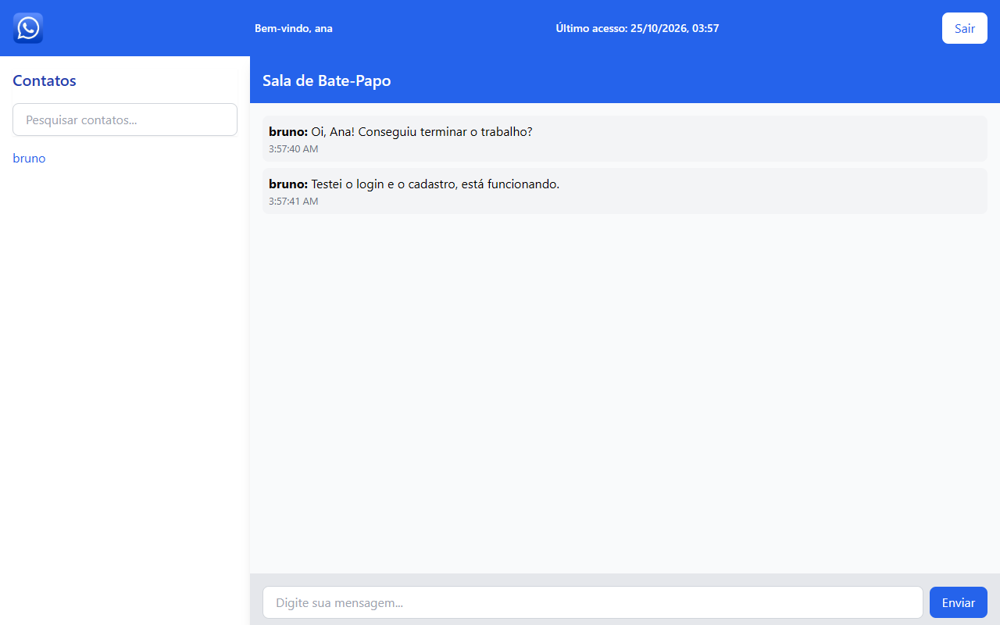
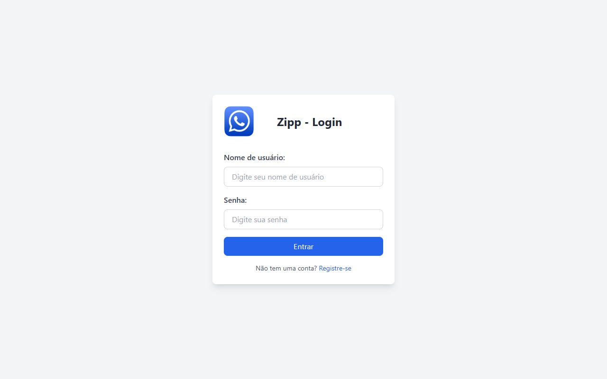
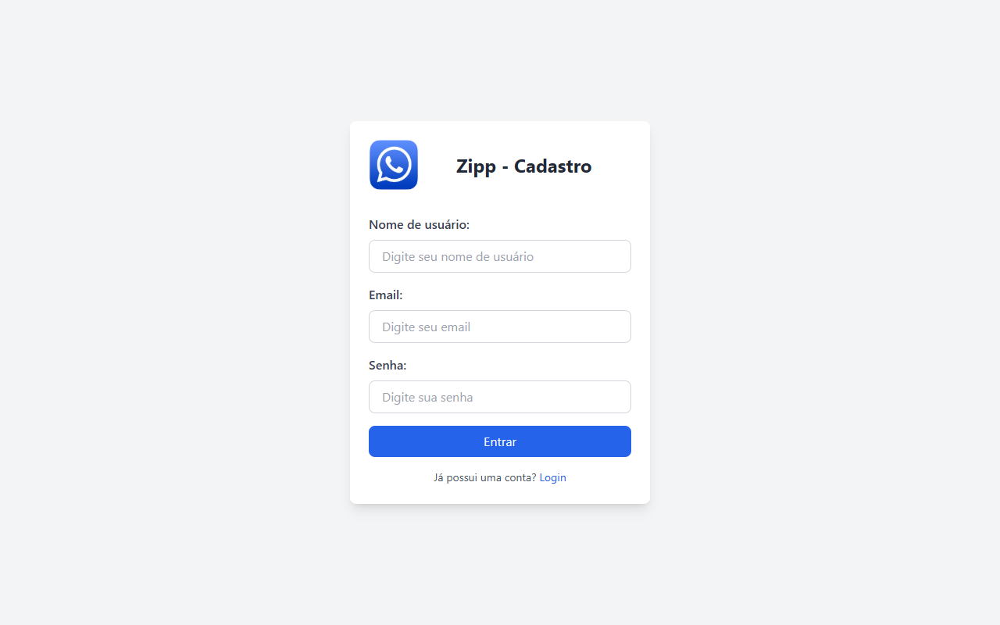

# Zipp — Bate-papo WEB (Trabalho Final PPI)

> Aplicação de bate-papo com login, cadastro de usuários e controle de sessão, feita com Express e publicado na Vercel.

**EN:** A small chat web app built with Express and server-side sessions. Users register, log in and exchange
private messages; the last access date is stored in a cookie.



## Sobre

Trabalho final da disciplina de **Programação para Internet** do curso de **ADS — FIPP/Unoeste**, no
**2º semestre de 2024**. O trabalho pedia uma aplicação web funcional com gerenciamento de sessões,
persistência temporária de dados e validação no lado do servidor. Foi entregue com aproveitamento máximo
nos critérios avaliativos e está publicado na Vercel.

O projeto não usa banco de dados: usuários e mensagens ficam em memória no servidor e são perdidos quando
ele reinicia.

## Funcionalidades

- Login e logout com sessão válida por 30 minutos.
- Cadastro de usuários com validação no servidor (nome com 3+ caracteres, e-mail válido, senha com 4+).
- Lista de contatos com todos os usuários cadastrados, exceto o usuário logado.
- Conversa privada entre dois usuários, com histórico cronológico e horário de cada mensagem.
- Bloqueio de mensagens vazias e de acesso às rotas internas sem login.
- Exibição do último acesso na tela principal, guardado em cookie.

## Tecnologias

- Node.js 18+
- Express 4.21.2
- express-session 1.18.1
- body-parser 1.20.3
- dotenv 17.x
- Tailwind CSS (via CDN)
- Vercel (deploy)

## Arquitetura

```
trabalho-final-ppi/
├── app.js                 # sobe o Express, configura sessão e registra as rotas
├── routes/
│   └── main.js            # rotas de login, cadastro, contatos e mensagens
├── public/
│   ├── login.html         # tela de login
│   ├── register.html      # tela de cadastro
│   ├── main.html          # tela principal com contatos e chat
│   └── assets/img/        # logo e ícone de logout
├── docs/screenshots/      # prints usados no README
└── vercel.json            # configuração de build na Vercel
```

As páginas são HTML estático servido por `express.static`; o estado fica em dois arrays dentro de
`routes/main.js` (`users` e `messagesStore`). O navegador conversa com o backend por `fetch` em JSON.

## Como rodar

### Pré-requisitos

- Node.js 18 ou superior

### Variáveis de ambiente

Copie `.env.example` para `.env`:

| Variável | Para que serve | Exemplo |
| --- | --- | --- |
| `PORT` | Porta do servidor | `3000` |
| `SESSION_SECRET` | Segredo que assina o cookie de sessão (obrigatório em produção) | `troque-por-um-valor-aleatorio-longo` |
| `NODE_ENV` | Ambiente da aplicação | `development` |

Com `NODE_ENV=production` e sem `SESSION_SECRET`, o servidor se recusa a subir. Em desenvolvimento, ele
usa um segredo temporário e avisa no console.

### Instalação e execução

```bash
npm install
npm start        # ou: npm run dev
```

Acesse `http://localhost:3000`.

### Usuários de teste

Não há seed: cadastre dois usuários em `/register` e entre com um deles para ver o outro na lista de
contatos. As contas existem só enquanto o servidor estiver rodando. As senhas ficam em memória, sem hash,
porque o foco do trabalho era sessão e validação — não use senhas reais.

## Uso / API

| Rota | Método | O que faz |
| --- | --- | --- |
| `/` | GET | Página de login |
| `/login` | POST | Valida usuário/senha e cria a sessão |
| `/logout` | GET | Encerra a sessão |
| `/register` | GET | Página de cadastro |
| `/cadastrarUsuario` | POST | Valida e cadastra um usuário |
| `/user` | GET | Nome do usuário logado |
| `/users` | GET | Lista de contatos (sem o usuário logado) |
| `/send-message` | POST | Envia uma mensagem |
| `/get-messages/:recipient` | GET | Histórico da conversa com um contato |
| `/main` | GET | Tela principal (exige login) |

## Telas

| Login | Cadastro |
| --- | --- |
|  |  |

## Testes

O projeto não tem testes automatizados. A verificação manual é cadastrar dois usuários, trocar mensagens
entre eles e conferir o último acesso exibido no topo da tela principal.

## Deploy

- Aplicação: <https://trabalho-final-ppi-kohl.vercel.app>

> **Atenção:** a variável `SESSION_SECRET` precisa ser cadastrada no projeto da Vercel antes do próximo
> deploy, senão a aplicação não sobe em produção.

## O que aprendi

<!-- TODO: pedir ao Thiago de 3 a 5 aprendizados técnicos deste projeto -->

## Licença

Distribuído sob a licença MIT. Veja [LICENSE](LICENSE).

## Autor

Thiago Enrico Costa Cardoso — [LinkedIn](https://www.linkedin.com/in/thiago-enrico-costa-cardoso/) · [Portfólio](https://teccdev.com.br/)
